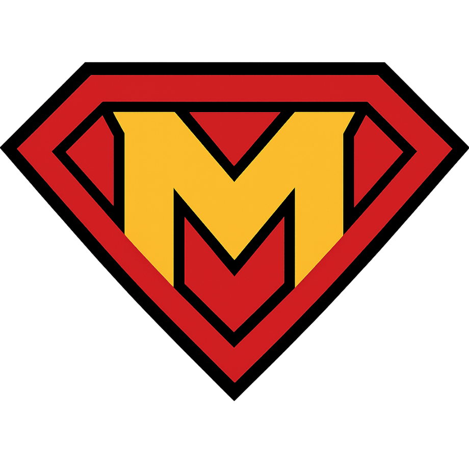

# Marvellous Codeworks Home

Official website of [Marvellous Codeworks](https://github.com/Marvellous-Codeworks), a small team building open-source software, available at **[marvellouscode.works](https://marvellouscode.works)**.

The site is built with [TanStack Start](https://tanstack.com/start), in English and Italian, and covers:

- **Projects**: [The Great-er Tab Discarder](https://marvellouscode.works/tgd), [The Marvellous Suspender](https://marvellouscode.works/tms) and [logdrop](https://marvellouscode.works/logdrop), with live stats from GitHub and the extension stores.
- **Blog**: the latest posts from the [knowledge base](https://kb.marvellouscode.works/blog).
- **TMS reports**: a [bug and feature report form](https://marvellouscode.works/tms/report) for people without a GitHub account.

Documentation for every project lives in the knowledge base, at [kb.marvellouscode.works](https://kb.marvellouscode.works).

## Repository layout

| Path | Content | URL |
| --- | --- | --- |
| `src/routes/` | File-based routes, see [`src/routes/README.md`](src/routes/README.md) | `/`, `/tgd`, `/tms`, `/logdrop` |
| `src/routes/tms_.*` | TMS privacy, terms and report pages | `/tms/privacy`, `/tms/terms`, `/tms/report` |
| `src/routes/api/` | Report endpoints | `/api/report/...` |
| `src/components/` | Shared UI: navigation, footer, galleries, release notes, report form | |
| `src/lib/` | Server functions (stats, releases, blog posts, reports) and translations (`i18n.tsx`) | |
| `src/assets/` | Images | |
| `public/` | Static files | `/...` |

Do not edit `src/routeTree.gen.ts` by hand: it is generated from `src/routes/`.

## Stack

| Layer | Technology |
| --- | --- |
| Framework | [TanStack Start](https://tanstack.com/start) + [TanStack Router](https://tanstack.com/router) |
| UI | React 19, [shadcn/ui](https://ui.shadcn.com/) (Radix UI primitives), Tailwind CSS v4 |
| Data fetching | TanStack Query, server functions |
| Markdown | react-markdown + remark-gfm (GitHub release notes) |
| Runtime | [Bun](https://bun.sh/) |
| Build | Vite 8, Nitro |
| Language | TypeScript |

## Local development

Requires [Bun](https://bun.sh/).

```bash
bun install        # install dependencies
bun run dev        # dev server with live reload
bun run build      # production build
bun run preview    # preview the production build locally
bun run lint       # ESLint
bun run format     # Prettier
```

The site needs no configuration to start. For live stats and the report flow, copy `.env.example` to `.env.local`, which is git-ignored, and fill in the values:

| Variable | Used for |
| --- | --- |
| `GITHUB_TOKEN` | GitHub stats on the project pages (read-only, optional) |
| `GITHUB_ISSUES_TOKEN` | Opening issues from the report form (fine-grained, Issues: write) |
| `RESEND_API_KEY` | Report confirmation emails |
| `REPORT_TOKEN_SECRET` | Signing the confirmation link |
| `SITE_URL` | Absolute links in emails |

## Report flow

The [report form](https://marvellouscode.works/tms/report) sends a confirmation email with a signed link. Once it is confirmed from that link, the report becomes an issue on [gioxx/MarvellousSuspender](https://github.com/gioxx/MarvellousSuspender) labeled `via-site-report`, and the reporter can follow it from a status page on the site.

## Deployment

The site runs on [Vercel](https://vercel.com/): every push to `main` goes to production, and every pull request gets a preview deployment. The build uses Nitro's `vercel` preset, see [`vite.config.ts`](vite.config.ts).

## Feedback

Found a mistake or have a suggestion? [Open an issue](https://github.com/Marvellous-Codeworks/MC-home/issues/new). For problems with the projects themselves, use their own repositories or the [report form](https://marvellouscode.works/tms/report).

## License

- **Code** (site source): [MIT](LICENSE).
- **Names and logos** (Marvellous Codeworks, TMS, TGD, logdrop, `src/assets/marvellous-logo*`, the `suspendy-guy` artwork): not covered by the license, all rights reserved. Third-party icons and images keep their own licenses.
- **The projects themselves** are not covered by this repository's license, see their own repositories.
